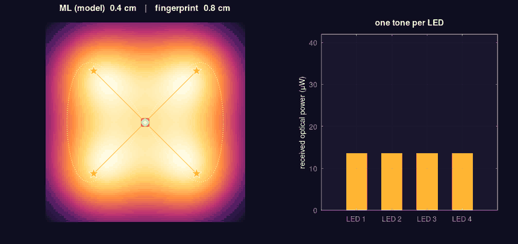
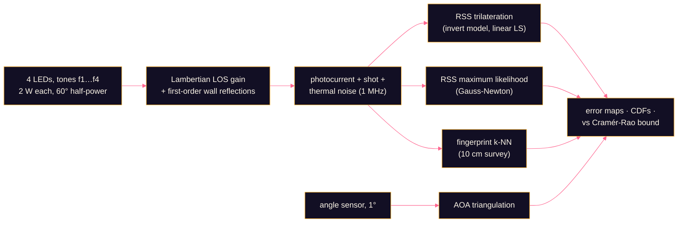
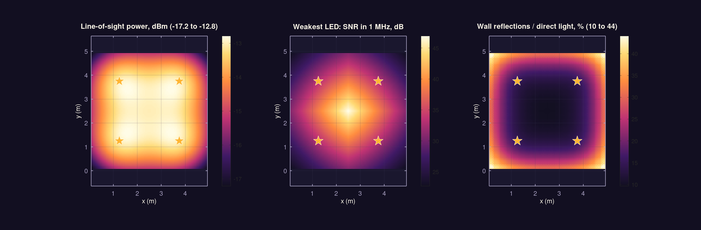
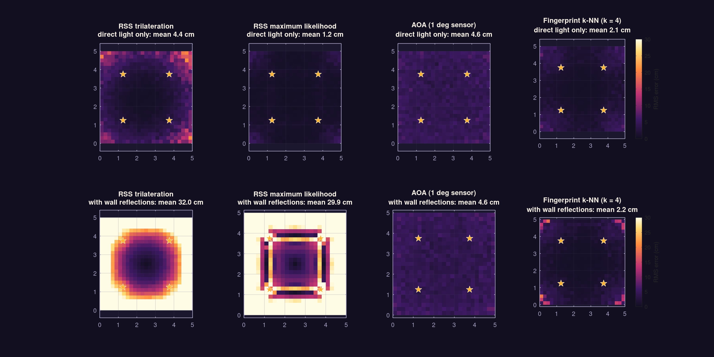
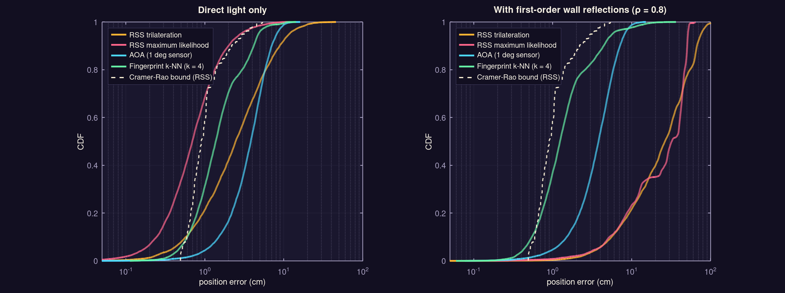
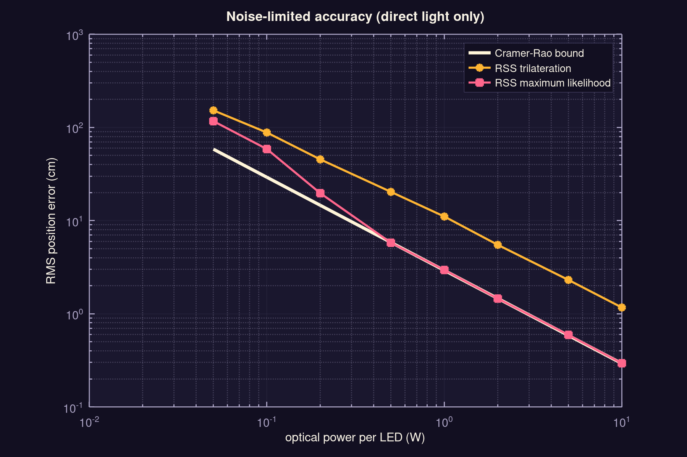
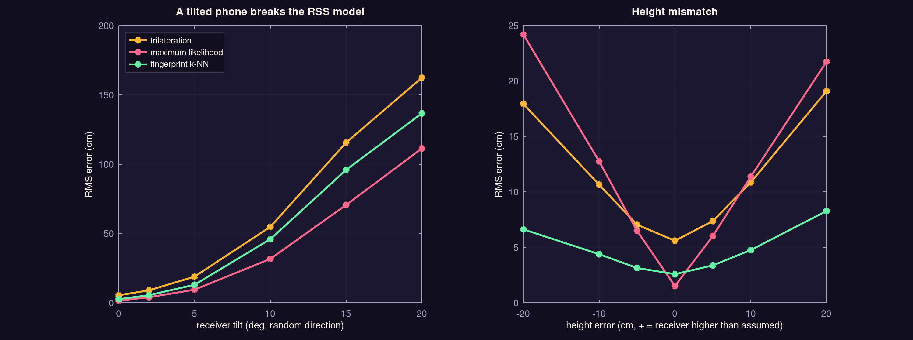

<p align="center"></p>

<p align="center">


</p>

<h3 align="center">GPS does not work indoors. The ceiling lights can do its job:<br>each LED flickers at its own frequency, too fast to see, and a photodiode works out where it is.</h3>

**Visible-light positioning (VLP)** uses ordinary LED lighting as a set of beacons. Each LED is modulated with its own tone; the receiver (a photodiode in a phone, robot or trolley) separates the tones and measures how much light comes from each lamp. Since the LED geometry is known, the light levels betray the position, with centimetre accuracy in the textbook.

This repository builds the whole chain in MATLAB: the Lambertian optical channel, first-order wall reflections, shot and thermal noise, four positioning methods and the Cramér-Rao bound. It also tests the assumptions the textbook makes and real rooms break: walls that reflect, phones that tilt, hands that hold the phone higher than the desk.

<table>
<tr>
<td align="center" width="25%"><h2>1.0 cm</h2><sub>mean error, maximum likelihood<br>on direct light: on the<br>Cramér-Rao bound</sub></td>
<td align="center" width="25%"><h2>30×</h2><sub>worse (29.7 cm) once wall<br>reflections are added: the<br>model no longer fits the room</sub></td>
<td align="center" width="25%"><h2>2.0 cm</h2><sub>fingerprinting in the same<br>room with reflections: a survey<br>learns what the model misses</sub></td>
<td align="center" width="25%"><h2>5° tilt</h2><sub>multiplies the error of every<br>RSS method by 3.5 to 6:<br>orientation matters as much as noise</sub></td>
</tr>
</table>

<p align="center"></p>
<p align="center"><sub>A walk through the real room (with wall reflections). Pink: maximum-likelihood estimate from the line-of-sight model. Green: fingerprint k-NN. Right: the power received from each of the four LEDs at that point.</sub></p>

---

## ☼ Run it

```matlab
>> main                          % MATLAB R2016b or newer, no toolboxes
```
```bash
octave --no-gui --eval main      # GNU Octave 6 or newer
```

About ten minutes. `main` writes five figures to [`figures/`](figures), the numbers to [`results/`](results) and [`results/summary.txt`](results/summary.txt). All numbers on this page come from running this code in **GNU Octave 10.3**; only base functions are used, so it runs as is in MATLAB.



## ☼ The physics

The direct-path DC gain from an LED to a photodiode at distance $d$, with emission angle $\phi$ and incidence angle $\psi$ (inside the field of view):

$$H_{\mathrm{LOS}} = \frac{(m+1)A}{2\pi d^2}\cos^m\phi\; T_s\, g(\psi)\cos\psi,\qquad m = \frac{-\ln 2}{\ln\cos\Phi_{1/2}}$$

Each wall patch $dA_w$ receives light from the LED and re-emits it as a Lambertian ($m = 1$) source with reflectivity $\rho = 0.8$ ([`nlos_gain.m`](src/nlos_gain.m), 10 cm patches). Noise follows Komine and Nakagawa (2004): shot noise of the signal and of 5.1 mA of background light, and the thermal noise of a FET preamplifier, in a 1 MHz positioning bandwidth.

| Setting | Value |
|:--|:--|
| Room | 5 × 5 × 3 m, LEDs at (1.25 / 3.75, 1.25 / 3.75, 3.0) m |
| LED | 2 W optical, half-power semi-angle 60° (m = 1) |
| Receiver | 1 cm² photodiode, FOV 70°, concentrator n = 1.5, responsivity 0.54 A/W, desk height 0.85 m |
| Noise | shot + thermal (Komine and Nakagawa 2004), bandwidth 1 MHz |
| Received power | −17.2 to −12.8 dBm; per-LED SNR 22.7 to 55.9 dB |
| Reflections / direct light | 10 % in the centre, 19 % median, 44 % in the corners |

## ☼ Results

### 1 · Light, noise and reflections in the room

<p align="center"></p>

The four light pools overlap into a power map flat to 4.4 dB. The weakest LED is still 22.7 dB above noise everywhere. The third map is the one that matters: **reflected light adds 10 % in the centre and up to 44 % near the walls**, and none of it is in the line-of-sight model.

### 2 · Four methods, two rooms

<p align="center"></p>
<p align="center"></p>

625 test points on a 20 cm grid, 10 noisy readings each:

| Method | Direct light only: mean / median / 90 % | With wall reflections: mean / median / 90 % |
|:--|--:|--:|
| RSS trilateration (model inverted per LED, linear LS) | 3.9 / 2.5 / 8.9 cm | 31.9 / 26.3 / 67.2 cm |
| **RSS maximum likelihood** (weighted Gauss-Newton) | **1.0** / 0.7 / 2.0 cm | 29.7 / 32.1 / 50.5 cm |
| AOA, 1° angle sensor | 4.1 / 3.8 / 7.0 cm | 4.1 / 3.8 / 7.1 cm |
| **Fingerprint k-NN** (10 cm survey, k = 4) | 1.9 / 1.4 / 4.2 cm | **2.0** / 1.2 / 4.4 cm |
| Cramér-Rao bound (RSS, per point) | 1.2 mean, 0.9 median, 5.4 max | (model mismatch: no bound) |

* With a perfect model, **maximum likelihood reaches the Cramér-Rao bound** (1.0 vs 1.2 cm mean). Trilateration loses a factor of four because it inverts each LED separately and the far LEDs are noisy, especially in the corners.
* Add the walls and both model-based methods fail by **30 cm**. The error is a bias, not noise, so more power does not help.
* **Fingerprinting does not care**: the survey measured the room as it is, reflections included. The price is the survey itself (2401 points here) and redoing it when the furniture moves.
* AOA is unaffected here because the angle sensor is assumed to see only the direct ray. That is optimistic; it is the case for a camera, less so for a quadrant photodiode.

### 3 · Noise-limited accuracy

<p align="center"></p>

With direct light only, maximum likelihood follows the bound from 0.5 W up: **5.8 cm at 0.5 W, 1.5 cm at 2 W, 2.9 mm at 10 W** (bound: 5.8 cm, 1.5 cm, 2.9 mm). Below 0.2 W the far LEDs drop into the noise and the estimator leaves the bound (1.17 m against 0.58 m at 50 mW). Trilateration stays a factor of 2 to 4 above it at every power.

### 4 · The assumptions: a level receiver at a known height

<p align="center"></p>

| Error source | Trilateration | Maximum likelihood | Fingerprint |
|:--|--:|--:|--:|
| none | 5.4 cm | 1.5 cm | 2.6 cm |
| 2° tilt | 9.0 cm | 4.0 cm | 5.5 cm |
| 5° tilt | 18.8 cm | 9.4 cm | 13.0 cm |
| 10° tilt | 54.8 cm | 31.6 cm | 45.9 cm |
| receiver 10 cm higher than assumed | 10.9 cm | 11.4 cm | 4.8 cm |
| receiver 20 cm lower than assumed | 17.9 cm | 24.2 cm | 6.6 cm |

A phone held in the hand tilts by 10° or more, which costs **every RSS method a factor of 10 to 21**. Positioning systems therefore read the phone's own orientation sensor and correct the incidence angles, or use angle-based receivers. Height errors hurt the model-based methods most; the fingerprint, matched on the pattern of the four powers rather than their absolute level, is the most forgiving.

## ☼ What is simplified

* Reflections stop at the first bounce from the four walls; floor and ceiling reflections, furniture and people are not modelled.
* The LEDs are perfectly separated by frequency, with no inter-tone leakage, and the tones are measured over one reading.
* The AOA sensor is an idealised device with 1° Gaussian angle noise on the direct path only.
* **Every number comes from GNU Octave 10.3.** No MATLAB licence was available on the build machine.

## ☼ Repository map

```
vlc-indoor-positioning/
├── main.m                  runs everything (about 10 min)
├── src/
│   ├── vlc_params.m        room, LEDs, receiver, noise constants
│   ├── los_gain.m          Lambertian line-of-sight gain (any receiver tilt)
│   ├── nlos_gain.m         first-order wall reflections
│   ├── noise_var.m         shot + thermal noise
│   ├── measure_rss.m       noisy readings
│   ├── est_lls.m, est_nlls.m, est_aoa.m, est_knn.m   the four methods
│   ├── crlb_rss.m          Cramér-Rao bound
│   └── palette.m, style_axes.m, ...
├── experiments/            exp1_channel … exp4_robustness, make_frames.m
├── figures/  results/  assets/
```

## ☼ References

1. T. Komine and M. Nakagawa, "Fundamental analysis for visible-light communication system using LED lights," *IEEE Trans. Consumer Electronics*, vol. 50, no. 1, 2004.
2. J. M. Kahn and J. R. Barry, "Wireless infrared communications," *Proc. IEEE*, vol. 85, no. 2, 1997.
3. W. Gu, M. Aminikashani, P. Deng, M. Kavehrad, "Impact of multipath reflections on the performance of indoor visible light positioning systems," *J. Lightwave Technol.*, vol. 34, no. 10, 2016.
4. Y. Zhuang *et al.*, "A survey of positioning systems using visible LED lights," *IEEE Commun. Surveys & Tutorials*, vol. 20, no. 3, 2018.
5. N. U. Hassan *et al.*, "Indoor positioning using visible LED lights: a survey," *ACM Computing Surveys*, vol. 48, no. 2, 2015.

## ☼ Licence

MIT © Eng. Jaafar Salim
